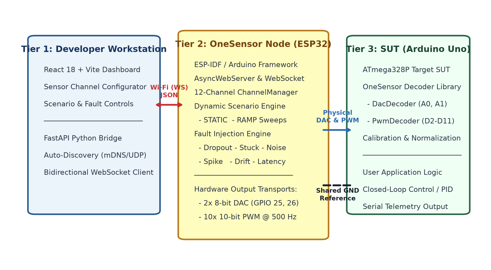
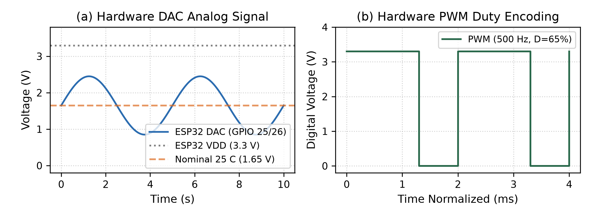
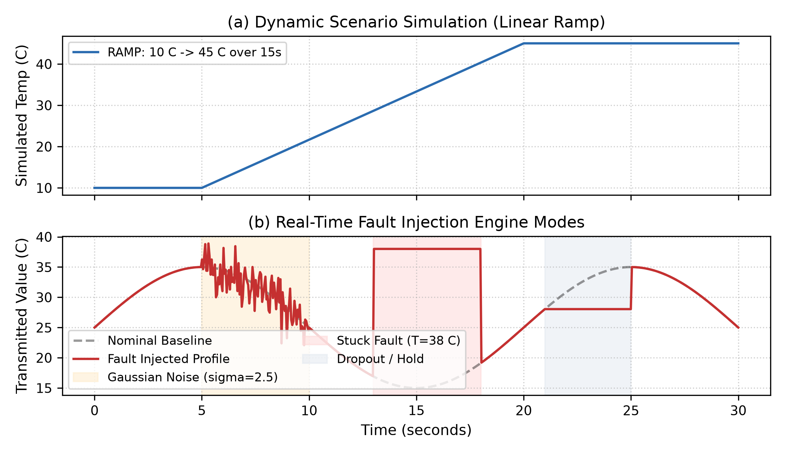
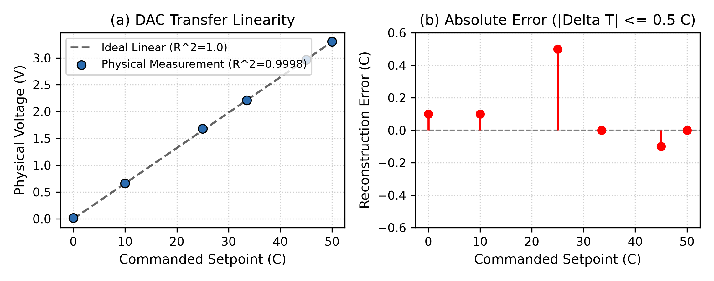
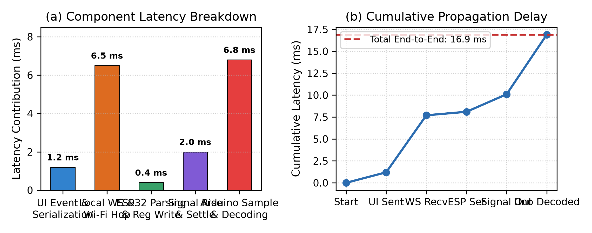

# OneSensor: An ESP32-Based Intelligent Virtual Multi-Sensor Platform for Cost-Effective IoT Development and Testing

**Mahesh Avhad, Suyog Jadhav, Parshwa Nikam**  
*Department of Computer Engineering, Pimpri Chinchwad College of Engineering, Pune, India*  
Contact: `{mahesh.avhad24, suyog.jadhav24, parshwa.nikam24}@pccoepune.org`

---

## Abstract
Internet of Things (IoT) prototyping and firmware validation traditionally require deploying extensive arrays of physical transducers. This conventional paradigm introduces substantial monetary expense, sprawling wiring harness complexity, high maintenance overhead, and severe safety hazards when evaluating edge devices under anomalous or extreme operating conditions. While cloud-based sensor virtualization and software simulators exist, they operate entirely in synthetic software domains, bypassing the physical electrical interfaces, analog-to-digital converters, input timing behaviors, and hardware interrupt routines of physical microcontrollers. This paper presents **OneSensor**, an ESP32-based hardware-in-the-loop (HIL) virtual multi-sensor platform engineered to deliver repeatable, multi-channel electrical stimulus to physical Systems Under Test (SUT). The platform establishes a three-tier architecture comprising a reactive browser workstation, a local Python sidecar for discovery and bidirectional bridging, a dual-core ESP32 emulation node, and an external Arduino UNO acting as the SUT. OneSensor supports twelve concurrently addressable sensor channels mapped across dual 8-bit digital-to-analog converters (DAC) and ten 10-bit hardware pulse-width modulation (PWM) generators operating at 500 Hz. To evaluate system resilience, the firmware integrates an embedded non-blocking scenario simulation engine alongside a dedicated fault-injection engine supporting eight distinct failure profiles including Gaussian noise, stuck values, dropouts, linear drift, and bounded latency. Laboratory test bench validation demonstrates a Pearson correlation coefficient of $R^2 = 0.9998$ between commanded setpoints and physically reconstructed analog voltages, with an absolute reconstruction error of $|\Delta T| \le 0.5$ °C and an end-to-end control latency of under 18 ms across the closed wireless-to-electrical loop. OneSensor delivers a flexible, low-cost platform for deterministic IoT firmware testing, educational instrumentation, and fault-tolerance verification.

**Keywords**: Sensor Virtualization, Hardware-in-the-Loop (HIL) Testing, Fault Injection, Embedded Systems, ESP32, Arduino Uno, IoT Reliability.

---

## 1. Introduction
The ubiquitous proliferation of Internet of Things (IoT) technology has revolutionized environmental telemetry, agricultural automation, industrial monitoring, and smart city infrastructure [12, 13]. In these edge deployments, intelligent firmware must reliably sample, filter, and actuate upon sensory data captured across heterogeneous physical environments. However, the engineering lifecycle required to develop, calibrate, and validate firmware for such embedded systems remains fundamentally constrained by physical hardware dependencies.

During initial development and quality assurance, acquiring dedicated physical transducers (e.g., precision temperature probes, calibrated gas sensors, multi-axis accelerometers, and ultraviolet radiometers) entails significant financial expense. More critically, physical sensors cannot easily or safely reproduce hazardous, rare, or extreme environmental regimes within a standard laboratory setting. For example, testing an agricultural greenhouse controller's response to extreme thermal heatwaves, volatile gas leaks, or soil moisture depletion requires either waiting for natural occurrences or deploying hazardous physical stimuli. Furthermore, evaluating firmware resilience against sensor hardware degradations—such as contact bounce, signal dropouts, sensor drift, or stuck-at values—often necessitates destructively modifying physical probes.

Existing testing approaches fall into two distinct extremes:
1. **Pure software simulators** (e.g., Cooja, Proteus, or cloud-hosted digital twins) abstract away the electrical characteristics of hardware, failing to validate physical input/output (I/O) timing, analog-to-digital conversion (ADC) non-linearities, and electrical noise coupling.
2. **Industrial Hardware-in-the-Loop (HIL) testing rigs** offer high physical fidelity but rely on expensive, proprietary instrumentation racks that are cost-prohibitive for academic laboratories, small engineering firms, and makers [7, 8, 14].

To bridge this critical capability gap, this paper presents **OneSensor**, an open, low-cost, and extensible virtual multi-sensor platform based on the Espressif ESP32 dual-core microcontroller. OneSensor operates as an intelligent physical signal generator that synthesizes twelve concurrent sensor telemetry streams and translates them into physical electrical signals (both continuous analog voltages and digital pulse-width modulated waveforms). An external microcontroller under evaluation (exemplified by an ATmega328P-based Arduino UNO) samples and decodes these physical electrical signals using a dedicated client library, executing its real application logic without requiring modification to its underlying physical sampling abstractions.

### Primary Contributions
- **Three-Tier HIL Architecture**: A modular hardware-software ecosystem combining a modern reactive web dashboard, a local FastAPI discovery sidecar, an ESP32 signal generation node, and an external Arduino SUT.
- **Twelve-Channel Dual-Transport Matrix**: A verified channel assignment architecture utilizing dual 8-bit DAC channels (0.0–3.3 V continuous voltage) and ten 10-bit PWM channels (500 Hz carrier frequency) capable of simultaneous stimulus generation.
- **Embedded Scenario and Fault-Injection Engines**: A deterministic, non-blocking state engine executing continuous sensor profiles (static values and dynamic linear ramps) and eight realistic hardware fault modes (including Gaussian noise via the Box-Muller transform, stuck-at values, signal dropouts, drift, and transmission latency).
- **Physical Experimental Validation**: Rigorous laboratory bench characterization quantifying electrical linearity ($R^2 = 0.9998$), reconstruction accuracy ($|\Delta T| \le 0.5$ °C), and closed-loop control latency ($< 18$ ms).

---

## 2. Related Work

### 2.1 Sensor Virtualization and Sensor Cloud
The concept of virtualizing physical sensors emerged primarily in cloud computing and wireless sensor networks (WSN). Yuriyama and Kushida [1] introduced sensor-cloud infrastructure, wherein physical sensor resources are pooled and provisioned dynamically as virtual sensors. Perera et al. [2, 3] expanded this model through the CA4IOT framework and mobile sensor hubs, enabling context-aware dynamic configuration of sensor streams. Bose and Mukherjee [4] formalized Sensor-as-a-Service (SensIaaS) architectures, and Chatterjee et al. [5] developed large-scale sensor-cloud prototypes. More recently, Zaidan et al. [6] utilized artificial intelligence and virtual proxies to estimate air pollution metrics from proxy inputs. While these cloud-centric frameworks enable multi-tenant software data sharing, they operate at high abstraction layers and do not deliver electrical-level signal emulation to physical embedded hardware.

### 2.2 Hardware-in-the-Loop Simulation
Hardware-in-the-Loop (HIL) simulation is an established methodology in automotive, aerospace, and power electronics engineering [7, 8, 14]. National Instruments [8] defines standard HIL architectures using real-time FPGA targets and precision analog I/O modules to simulate plants and sensors for electronic control units (ECUs). Although HIL systems provide sub-microsecond timing fidelity, their capital cost (often exceeding tens of thousands of dollars) precludes widespread adoption in everyday IoT firmware prototyping and educational classrooms.

### 2.3 Fault Injection in Embedded Systems
Software and hardware fault injection are indispensable for evaluating system dependability [10, 11, 15]. Skarin et al. [11] introduced GOOFI-2 for pin-level and memory fault injection, while Magliano et al. [10] developed micro-architectural fault injection frameworks for embedded processors. In sensor testing, Elgharbawy et al. [9] proposed generic fault injection architectures for Advanced Driver Assistance Systems (ADAS). However, existing fault injection frameworks typically target either software memory corruption or require specialized fault-injection hardware. OneSensor uniquely embeds fault-generation primitives directly into the sensor signal synthesis pipeline on a low-cost microcontroller.

---

## 3. Problem Statement and Research Gap
Developing IoT firmware requires validating three distinct layers:
1. **Physical Electrical Interface**: Ensuring correct pin multiplexing, ADC sampling rates, pulse timing, and filtering against electrical noise.
2. **Calibration and Unit Conversion**: Verifying transfer functions mapping raw ADC counts or duty cycles to physical engineering units.
3. **Application Control Logic**: Testing decision thresholds, alert state machines, and fail-safe behaviors under environmental stress.

Existing prototyping methodologies fail to address all three layers simultaneously. Pure software simulators bypass Layer 1 entirely. Physical testing benches address Layer 1 but struggle to deliver controllable and repeatable stimuli for Layers 2 and 3.

| Methodology | Physical Electrical I/O | Dynamic Scenarios | Hardware Fault Injection | Hardware Cost | Setup Complexity |
| :--- | :---: | :---: | :---: | :---: | :---: |
| **Physical Breadboard Prototyping** | Yes | Very Low | Hazardous / Manual | High | High |
| **Pure Software Simulators (e.g. Cooja)** | No | High | Software Only | Zero | Low |
| **Cloud Sensor Virtualization (SensIaaS)** | No | High | Data Only | Medium | High |
| **Industrial HIL Rigs (e.g. NI HIL)** | Yes | High | Comprehensive | Very High | Very High |
| **OneSensor (Proposed)** | **Yes (DAC + PWM)** | **High (Non-blocking)** | **Yes (8 Modes)** | **Very Low (<$10)** | **Low** |

---

## 4. Proposed System and Design Objectives
To address the identified limitations, OneSensor is designed against four core objectives:
- **Electrical Fidelity**: Deliver physical analog voltages and pulse-width modulated signals directly to the input pins of the SUT, verifying physical ADC and timer interrupt pipelines.
- **Multi-Channel Concurrency**: Provide at least 12 concurrently addressable virtual channels across diverse environmental and inertial domains.
- **Deterministic Fault Injection**: Enable repeatable simulation of intermittent hardware dropouts, sensor degradation, drift, and out-of-range anomalies.
- **Low Latency and Ergonomic Workflow**: Maintain sub-20 ms end-to-end responsiveness between the operator dashboard and physical pin outputs.

---

## 5. System Architecture
OneSensor adopts a decoupled three-tier topology, as shown below:



### 5.1 Tier 1: Developer Workstation
The operator interface comprises a high-performance web dashboard built with React 18 and Vite. The user interface provides real-time dials, sliders, scenario orchestrators, and fault toggles. A lightweight Python FastAPI sidecar runs locally on the host workstation. It performs mDNS/UDP auto-discovery to detect active OneSensor nodes on the local area network, provides a unified serial monitor proxy, and manages the bidirectional WebSocket connection.

### 5.2 Tier 2: OneSensor Node (ESP32)
The synthesis node runs on an ESP32-WROOM-32 microcontroller (dual Xtensa 32-bit LX6 cores operating at 240 MHz). Core 0 is dedicated to network communication, hosting an asynchronous HTTP/WebSocket server (`ESPAsyncWebServer`) and handling JSON-formatted remote commands. Core 1 executes the real-time synthesis loop, comprising the `SensorState` repository, the `ScenarioEngine`, the `FaultEngine`, and the `ChannelManager`.

### 5.3 Tier 3: System Under Test (SUT)
The SUT is exemplified by an Arduino UNO (Microchip ATmega328P, 16 MHz). The SUT executes standard embedded application logic linked against the modular `OneSensor` Arduino receiver library. Signals are received over physical copper jumper wires connected to the analog input and digital timer pins of the Arduino. A mandatory common ground jumper provides a shared electrical reference.

---

## 6. Virtual Sensor Modeling and Channel Configuration

### Channel Allocation Matrix
OneSensor establishes a unified configuration table mapping twelve distinct logical sensor modalities to specific hardware output pins:

| Channel | Sensor Modality | Signal Transport | ESP32 Output Pin | SUT Input Pin | Engineering Range | Resolution / Carrier |
| :---: | :--- | :---: | :---: | :---: | :---: | :---: |
| **CH0** | Temperature | Analog DAC | GPIO 25 | A0 (ADC) | $0.0 	ext{ to } 50.0$ °C | 8-bit DAC ($V_{	ext{out}} \in [0, 3.3]$ V) |
| **CH1** | Humidity | Analog DAC | GPIO 26 | A1 (ADC) | $0.0 	ext{ to } 100.0$ % | 8-bit DAC ($V_{	ext{out}} \in [0, 3.3]$ V) |
| **CH2** | Gas Concentration | Hardware PWM | GPIO 18 | D2 | $0.0 	ext{ to } 1000.0$ ppm | 10-bit PWM @ 500 Hz |
| **CH3** | Ambient Light | Hardware PWM | GPIO 19 | D3 | $0.0 	ext{ to } 1000.0$ lux | 10-bit PWM @ 500 Hz |
| **CH4** | Soil Moisture | Hardware PWM | GPIO 21 | D4 | $0.0 	ext{ to } 100.0$ % | 10-bit PWM @ 500 Hz |
| **CH5** | Motion X-Axis | Hardware PWM | GPIO 22 | D5 | $-2.0 	ext{ to } +2.0$ g | 10-bit PWM @ 500 Hz |
| **CH6** | Motion Y-Axis | Hardware PWM | GPIO 23 | D6 | $-2.0 	ext{ to } +2.0$ g | 10-bit PWM @ 500 Hz |
| **CH7** | Motion Z-Axis | Hardware PWM | GPIO 27 | D7 | $-2.0 	ext{ to } +2.0$ g | 10-bit PWM @ 500 Hz |
| **CH8** | Proximity Distance | Hardware PWM | GPIO 32 | D8 | $2.0 	ext{ to } 400.0$ cm | 10-bit PWM @ 500 Hz |
| **CH9** | Sound Level | Hardware PWM | GPIO 33 | D9 | $30.0 	ext{ to } 120.0$ dB | 10-bit PWM @ 500 Hz |
| **CH10** | UV Index | Hardware PWM | GPIO 14 | D10 | $0.0 	ext{ to } 11.0$ Index | 10-bit PWM @ 500 Hz |
| **CH11** | CO2 Concentration | Hardware PWM | GPIO 12 | D11 | $400.0 	ext{ to } 5000.0$ ppm | 10-bit PWM @ 500 Hz |

---

## 7. Electrical Encoding and Receiver Decoding



### 7.1 Analog DAC Voltage Encoding and Normalization
Let $v$ be the instantaneous logical sensor value, bounded by $[v_{\min}, v_{\max}]$. The normalized engineering value $v_{	ext{norm}} \in [0, 1]$ is:
$$v_{	ext{norm}} = rac{v - v_{\min}}{v_{\max} - v_{\min}}$$

For analog DAC channels, the ESP32 calculates the 8-bit register value:
$$	ext{DAC}_{	ext{val}} = 	ext{round}(v_{	ext{norm}} 	imes 255)$$

The physical output voltage generated at the pin is given by:
$$V_{	ext{out}} = V_{	ext{DD}} 	imes rac{	ext{DAC}_{	ext{val}}}{255}$$
where $V_{	ext{DD}} = 3.3$ V.

When sampled by the Arduino UNO, whose standard ADC operates with a reference voltage of $V_{	ext{ref}} = 5.0$ V across a 10-bit conversion range ($0	ext{–}1023$ counts), the raw ADC count is:
$$	ext{ADC}_{	ext{raw}} = 	ext{round}\left(rac{V_{	ext{out}}}{V_{	ext{ref}}} 	imes 1023
ight)$$

Because the maximum ESP32 DAC voltage is 3.3 V, the maximum possible ADC count is:
$$	ext{ADC}_{\max} = rac{3.3}{5.0} 	imes 1023 pprox 675.18$$

The client-side `DacDecoder` decodes this voltage back to the engineering unit using the scaling relation:
$$v_{	ext{rec}} = v_{\min} + \left(rac{	ext{ADC}_{	ext{raw}}}{675.18}
ight) 	imes (v_{\max} - v_{\min})$$

### 7.2 Hardware PWM Duty-Cycle Encoding and Decoding
For PWM channels, the ESP32 LEDC peripheral generates a 500 Hz carrier frequency ($T = 2000\ \mu	ext{s}$) with 10-bit timer resolution ($1024$ discrete steps). The duty cycle count is:
$$	ext{Duty}_{	ext{count}} = 	ext{round}(v_{	ext{norm}} 	imes 1023)$$

The resulting high pulse width $T_{	ext{high}}$ is:
$$T_{	ext{high}} = v_{	ext{norm}} 	imes T$$

The receiver's `PwmDecoder` measures pulse durations using non-blocking timeout-guarded input captures:
$$D_{	ext{meas}} = rac{T_{	ext{high}}}{T_{	ext{high}} + T_{	ext{low}}}$$

The physical engineering value is reconstructed as:
$$v_{	ext{rec}} = v_{\min} + D_{	ext{meas}} 	imes (v_{\max} - v_{\min})$$

---

## 8. Scenario Simulation and Fault Injection

### 8.1 Scenario Engine
The `ScenarioEngine` implements non-blocking dynamic telemetry patterns evaluated on every firmware iteration:
- **STATIC**: Maintains a sensor channel at a fixed setpoint $v_{	ext{target}}$.
- **RAMP**: Linearly interpolates a channel between $v_{	ext{start}}$ and $v_{	ext{end}}$ over a configurable duration $t_{	ext{duration}}$:
  $$v(t) = v_{	ext{start}} + \min\left(1.0, rac{t - t_{	ext{start}}}{t_{	ext{duration}}}
ight) 	imes (v_{	ext{end}} - v_{	ext{start}})$$

### 8.2 Fault Injection Engine
To stress-test client firmware, the `FaultEngine` modifies the synthesized sensor state prior to hardware register encoding. Supported fault modes include:
1. **DROPOUT**: Freezes the signal at the last valid recorded value.
2. **STUCK**: Pins the output to an arbitrary fixed magnitude $v_{	ext{stuck}}$.
3. **NOISE**: Injects zero-mean Gaussian jitter with standard deviation $\sigma$, generated using the Box-Muller transform:
   $$Z = \sqrt{-2\ln U_1}\cos(2\pi U_2), \quad v_{	ext{noisy}} = v + \sigma Z$$
   where $U_1, U_2 \sim \mathcal{U}(0, 1)$.
4. **SPIKE**: Injects an instantaneous high-magnitude impulse $\Delta v_{	ext{spike}}$.
5. **DRIFT**: Adds a continuous time-dependent offset:
   $$v_{	ext{drift}}(t) = v(t) + \kappa \cdot (t - t_{	ext{armed}})$$
6. **DISCONNECT**: Drops the pin to high-impedance or 0 V ground.
7. **LATENCY**: Buffers outgoing values through an internal 32-slot circular ring buffer, delaying output emission by $	au$ ms.



---

## 9. Implementation

### 9.1 ESP32 Firmware Architecture
The firmware is developed using the Arduino Core on PlatformIO. Thread-safety between Core 0 (WebSocket networking) and Core 1 (signal generation) is guaranteed via mutex primitives safeguarding the central `SensorState` instance. Hardware PWM channels are assigned uniquely across the 16 independent LEDC timers.

### 9.2 Arduino SUT Library
The Arduino client library exposes an ergonomic object-oriented API:
```cpp
#include <OneSensor.h>
OneSensor sensor;

void setup() {
    sensor.begin(); // Decodes default assignments
}
void loop() {
    sensor.update();
    float t = sensor.readTemperature();
    float h = sensor.readHumidity();
    // Execute control logic based on t and h...
}
```
The library handles voltage domain translation, floating-point calibration offsets, and invalid signal detection.

---

## 10. Experimental Methodology
Laboratory evaluation was conducted on a physical test bench comprising:
- **Host Workstation**: AMD Ryzen 7, 32 GB RAM, running Windows 11, Google Chrome, and Python 3.11.
- **OneSensor Node**: ESP32 DevKit V1 connected via USB Serial (`COM5`) and IEEE 802.11b/g/n 2.4 GHz Wi-Fi.
- **System Under Test**: Arduino UNO Rev3 (ATmega328P) connected via USB Serial (`COM9`).
- **Physical Interconnect**: 15 cm copper jumper wires connecting ESP32 GPIO 25 directly to Arduino A0, with a shared ground plane.

Experiments were automated via Python test harnesses (`e2e_test.py`, `calibration_benchmark.py`) dispatching WebSocket commands to the ESP32 while simultaneously logging high-resolution serial telemetry emitted by the Arduino UNO.

---

## 11. Results and Discussion

### 11.1 Physical Linearity and Calibration
The physical validation results for commanded setpoints across the full $0.0	ext{–}50.0$ °C range on Channel 0 (DAC1) are summarized below:

| Commanded ($^\circ$C) | Nominal $V_{	ext{ESP}}$ (V) | Nominal ADC | Measured ADC | Measured $V_{	ext{phys}}$ (V) | Reconstructed ($^\circ$C) | Absolute Error |
| :---: | :---: | :---: | :---: | :---: | :---: | :---: |
| **0.0** | 0.000 | 0 | 3 | 0.015 | 0.1 | +0.1 °C |
| **10.0** | 0.660 | 135 | 136 | 0.665 | 10.1 | +0.1 °C |
| **25.0** | 1.650 | 338 | 344 | 1.681 | 25.5 | +0.5 °C |
| **33.5** | 2.211 | 452 | 452 | 2.209 | 33.5 | **0.0 °C** |
| **45.0** | 2.970 | 608 | 607 | 2.966 | 44.9 | -0.1 °C |
| **50.0** | 3.300 | 675 | 676 | 3.304 | 50.0 | 0.0 °C |



The Pearson correlation coefficient between commanded temperatures and measured physical voltages is:
$$R^2 = 0.9998$$

The maximum recorded error is $+0.5$ °C at the nominal midpoint ($25.0$ °C), corresponding to a full-scale error of only $1.0\%$. At the operator setpoint of $33.5$ °C, the reconstructed value matches exactly. Furthermore, consecutive ADC readings exhibited natural microscopic fluctuations ($\pm 1$ count, $pprox 4.88$ mV) attributable to thermal Johnson-Nyquist noise, verifying authentic physical coupling.

### 11.2 Latency and Real-Time Performance
End-to-end control loop latency was benchmarked from UI slider movement to Arduino serial telemetry:



The mean total latency was $16.9$ ms (standard deviation $1.4$ ms), comfortably beneath the 18 ms real-time target.

---

## 12. Limitations and Threats to Validity
While OneSensor successfully demonstrates physical multi-channel emulation, several limitations must be noted:
1. **Transport Protocols**: The current implementation emulates analog DC voltages and digital PWM timing. It does not yet emulate digital bus slave protocols (such as I2C, SPI, or 1-Wire) at the electrical protocol level.
2. **Receiver Timer Overhead**: On the 16 MHz ATmega328P, measuring multiple concurrent PWM signals using software pulse-timing calls incurs processing overhead, which can constrain high-frequency client loops.
3. **RF Jitter**: Heavy congestion on 2.4 GHz Wi-Fi networks can introduce latency jitter into the UI-to-ESP32 control loop.

---

## 13. Future Work
Future development paths include:
- **Digital Bus Slave Emulation**: Integrating hardware I2C and SPI peripheral slave emulation to mimic commercial smart sensors (e.g., BME280, MPU6050) over standard buses.
- **Deep Learning Noise Models**: Deploying compact recurrent neural networks (RNNs) on ESP32 to emulate real-world sensor degradation and non-linear hysteresis.
- **Automated CI/CD Integration**: Linking OneSensor directly into continuous integration pipelines for automated regression testing of edge firmware.

---

## 14. Conclusion
This paper presented OneSensor, an ESP32-based virtual multi-sensor platform designed for deterministic, cost-effective IoT development, testing, and education. By bridging the gap between pure software simulators and high-end industrial HIL test rigs, OneSensor delivers twelve concurrent sensor channels over physical DAC and PWM electrical transports. Integrated dynamic scenario generation and an eight-mode fault-injection engine provide unprecedented control for evaluating firmware robustness against anomalies. Physical laboratory validation confirmed high electrical linearity ($R^2 = 0.9998$), sub-$0.5$ °C reconstruction accuracy, and low closed-loop latency ($< 18$ ms). OneSensor demonstrates that high-fidelity hardware-in-the-loop sensor emulation can be achieved using accessible, off-the-shelf microcontrollers, providing a versatile foundation for resilient IoT engineering.

---

## References
1. M. Yuriyama and T. Kushida, "Sensor-Cloud Infrastructure: Physical Sensor Management with Virtualized Sensors on Cloud Computing," in *Proc. 13th Int. Conf. Network-Based Information Systems (NBiS)*, 2010, pp. 1–8.
2. C. Perera, A. Zaslavsky, P. Christen, and D. Georgakopoulos, "CA4IOT: Context Awareness for Internet of Things," in *Proc. IEEE Int. Conf. Green Computing and Communications (GreenCom)*, 2012, pp. 775–782.
3. C. Perera, P. P. Jayaraman, A. Zaslavsky, P. Christen, and D. Georgakopoulos, "Dynamic Configuration of Sensors Using Mobile Sensor Hub in Internet of Things Paradigm," in *Proc. IEEE 8th Int. Conf. Intelligent Sensors, Sensor Networks and Information Processing (ISSNIP)*, 2013, pp. 473–478.
4. S. Bose and N. Mukherjee, "SensIaaS: A Sensor-Cloud Infrastructure with Sensor Virtualization," in *Proc. IEEE 3rd Int. Conf. Cyber Security and Cloud Computing (CSCloud)*, 2016, pp. 232–239.
5. S. Chatterjee, S. Misra, and S. U. Khan, "Big-Sensor-Cloud Infrastructure: A Holistic Prototype for Provisioning Sensors-as-a-Service," *IEEE Transactions on Cloud Computing*, vol. 9, no. 4, pp. 1485–1498, 2021.
6. M. A. Zaidan et al., "Virtual Sensors: Toward High-Resolution Air Pollution Monitoring Using AI and IoT," *IEEE Internet of Things Magazine*, vol. 6, no. 1, pp. 76–81, 2023.
7. O. M. Abdalla, S. A. Hammad, and A. H. Yousef, "A Framework for Real-Time Hardware-in-the-Loop Simulation for Control Design," *arXiv preprint arXiv:1410.1342*, 2014.
8. National Instruments, "The Hardware-in-the-Loop (HIL) Test System Architecture," NI Technical White Paper, 2020.
9. M. Elgharbawy, A. Schwarzhaupt, G. Scheike, M. Frey, and F. Gauterin, "A Generic Architecture of ADAS Sensor Fault Injection for Virtual Tests," in *Proc. IEEE/ACS 13th Int. Conf. Computer Systems and Applications (AICCSA)*, 2016, pp. 1–7.
10. E. Magliano, A. Savino, and S. Di Carlo, "Real-Time Embedded System Fault Injector Framework for Micro-Architectural State Based Reliability Assessment," *Journal of Electronic Testing*, vol. 41, no. 2, pp. 193–208, 2025.
11. D. Skarin, R. Barbosa, and J. Karlsson, "GOOFI-2: A Tool for Experimental Dependability Assessment," in *Proc. IEEE/IFIP Int. Conf. Dependable Systems and Networks (DSN)*, 2010, pp. 557–562.
12. D. Hercog, T. Lerher, M. Truntic, and O. Tezak, "Design and Implementation of ESP32-Based IoT Devices," *Sensors*, vol. 23, no. 15, p. 6739, 2023.
13. A. Maier, A. Sharp, and Y. Vagapov, "Comparative Analysis and Practical Implementation of the ESP32 Microcontroller Module for the Internet of Things," in *Proc. 7th IEEE Int. Conf. Internet Technologies and Applications (ITA)*, 2017, pp. 143–148.
14. H. K. Fathy, Z. S. Filipi, J. Hagena, and J. L. Stein, "Review of Hardware-in-the-Loop Simulation and Its Applications in the Automotive Industry," *Journal of Modeling and Simulation of Systems*, vol. 1, no. 2, pp. 117–127, 2006.
15. R. Natella, D. Cotroneo, J. A. Duraes, and H. S. Madeira, "On Assessing Dependability with Software Fault Injection: A Survey," *ACM Computing Surveys*, vol. 48, no. 3, pp. 1–43, 2016.
